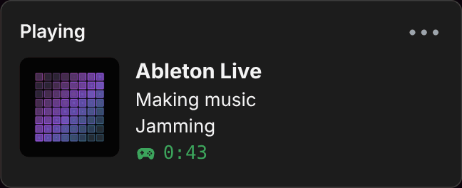
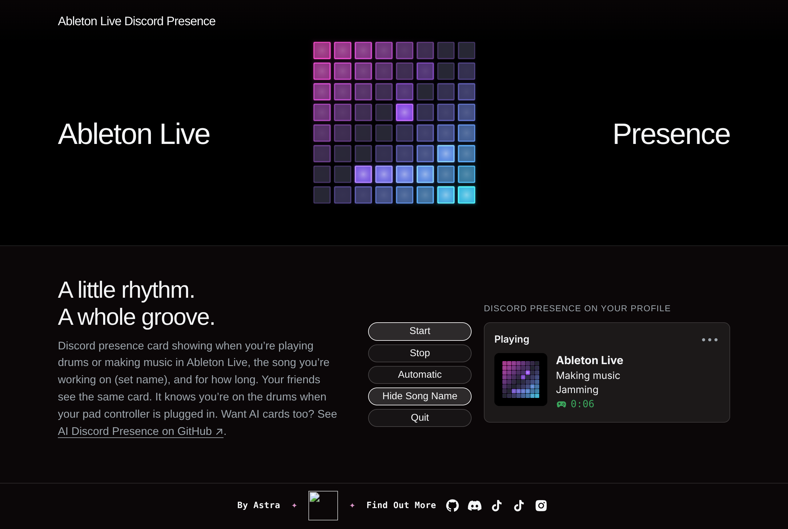

# Ableton Live Discord Presence

*By Astra.* Let your Discord friends see when you're playing drums or making music in Ableton Live. One small Windows
app.

## The Card

What your friends see on your Discord profile while the app is sharing:

- **Playing drums** while Ableton Live is open and your drum gear (an APC64 by default) is plugged in.
  **Making music** when only Ableton is open.
- **Working on …** shows the open set's name. An unsaved set ("Untitled") shows **Jamming**, and you can turn names off.
- Hover the picture to see your Live version, such as Live 12 Trial.
- The card appears a few seconds after Ableton opens and disappears when Ableton closes.

## Official Artwork

An original neon 8×8 pad grid on graphite gray, lighting up in a drum pattern, drawn in code by
`scripts/make-pad-art-20261102.js` (free; never Ableton's or Akai's logos). The app's page draws the same pads live;
Discord shows `public/pad-grid-card-20261102.gif`.

## The App

A small program on your PC. Its page opens in your browser and shows a live preview of your card.

<b><a href="https://github.com/findastra/ableton-live-discord-presence/raw/main/downloads/ableton-live-discord-presence.zip">⬇ Download for Windows</a></b>

**Needs:** Windows, [Node.js 24 or later](https://nodejs.org/en/download) and the Discord desktop app with activity
sharing on (User Settings › Activity Privacy › *Share your detected activities with others*).

1. Extract the download somewhere it can stay and double-click **Start Ableton Live Discord Presence.cmd**. No
   `npm install` is needed.
2. Optional: double-click **Enable Automatic Startup.cmd** once to start it quietly with Windows.

The app uses its own Discord application, "Ableton Live Presence", so there is nothing to set up.

### Buttons & Instructions

<table>
<tr>
<th width="200">Button</th>
<th>What it does</th>
</tr>
<tr>
<td width="200" align="center" valign="middle"></td>
<td valign="middle">Puts the card on your profile now and starts the timer, until you click Stop or Quit, even before Ableton opens.</td>
</tr>
<tr>
<td width="200" align="center" valign="middle"></td>
<td valign="middle">Takes the card off your profile. The app keeps running.</td>
</tr>
<tr>
<td width="200" align="center" valign="middle"></td>
<td valign="middle">Shows the card while Ableton Live is open, and takes it off when Ableton closes.</td>
</tr>
<tr>
<td width="200" align="center" valign="middle"></td>
<td valign="middle">Takes the set's name off the card (it says Jamming). Click it again (Show Song Name) to put it back.</td>
</tr>
<tr>
<td width="200" align="center" valign="middle"></td>
<td valign="middle">Closes the app. Click it twice within 3 seconds.</td>
</tr>
</table>

## Quirks

1. Windows and Discord desktop only (not the browser version of Discord).
2. **Playing drums** means your drum gear is plugged in while Ableton is open, not that you are hitting pads that very
   second. Reading pad hits would mean opening the APC64, which Windows usually lets only one program do.
3. **Privacy:** the app reads only Ableton Live's window title (for the set name and Live version) and whether a Windows
   device with your drum gear's name is plugged in. It never reads audio, MIDI notes, set files or anything inside
   Ableton, and it does not open the APC64, so Ableton keeps it to itself. Nothing leaves your PC except the card.
   Settings stay in `.local/config.json` in the app folder.
4. AI Discord Presence, the IPO countdowns and this app can run together, but Discord may show only one card; check
   your profile to see what friends see.
5. To update, click **Quit** in the old copy first (the launcher refuses to let an older copy stand in), and run
   **Enable Automatic Startup.cmd** again if you moved the folder.

## Coming Next

For now the card says **Playing drums** (or **Making music**) and **Jamming** when the set has no name. Planned:

- **Say exactly what you're playing**, for example "Playing APC64", from the device name the app already finds.
- **Any gear and software**: DJs and music producers add their own controllers, drum kits, decks and programs
  (other music and DJ software too), and the card names what they're using.

## Developer Notes

1. **What's where:**

   | Path | What it does |
   | --- | --- |
   | `src/card-20261102.js` | What the card says, and the settings |
   | `src/detector-20261102.js` | Finds Ableton's window and the drum gear |
   | `src/rpc-20261102.js` | Talks to Discord desktop over its local pipe |
   | `src/server-20261102.js` | The app: the control page at port 38765 and the card updates |
   | `src/launch-20261102.js` | Starts the app once, or opens the page if it's already running |
   | `src/windows-startup-20261102.js` | Writes or removes `ableton-live-discord-presence-20261102.vbs` in the Startup folder |
   | `public/pad-art-20261102.js` | The one drawing behind all three pictures: the live pads on the page, the card GIF and the icon |
   | `scripts/make-pad-art-20261102.js` | Makes the card GIF and the 1024×1024 icon (its first frame) from that drawing (`npm run art`) |
   | `scripts/package-20261115.mjs` | Builds `downloads/ableton-live-discord-presence.zip` (`npm run package`) |
   | `docs/images/` | The README pictures |

2. **Run from source:** `node src/server-20261102.js`. The page is port 38765 on this PC only; `ABLETON_PRESENCE_PORT`
   changes it. The server listens on 127.0.0.1 only and checks Host and Origin on every change.
3. **Tests:** `node --test`. Add tests with every behavior change. **Rebuild the download** with
   `node scripts/package-20261115.mjs` before pushing any app change. No dependencies.
4. **The card's art** is loaded by Discord from `public/pad-grid-card-20261102.gif` on this repo's `main` branch
   (`PAD_GRID_URL` in `src/card-20261102.js`); when the art changes, bump its `?v=`.
5. **Rules and handoffs:** [CLAUDE.md](CLAUDE.md) and [AGENTS.md](AGENTS.md) for contributors and AI assistants; open
   work in [handoffs/](handoffs/README.md); report a vulnerability through [SECURITY.md](SECURITY.md). Discord Damsel
   ([Astra's PetOS](https://github.com/findastra/astras-pet-os)) starts and stops it.

## Credits

1. Built with Claude Opus 5.5, from 2026-11-02, together with the pad-grid art and its GIF writer.
2. Laid out like [AI Discord Presence](https://github.com/findastra/ai-discord-presence) on 2026-11-15.
3. Full list: the "Built with" lines in [AGENTS.md](AGENTS.md).

## License

MIT, see [LICENSE](LICENSE).

Ableton, Ableton Live, Akai, APC64 and Discord are trademarks of their owners. This is an independent project, not
made, endorsed or sponsored by them; their names appear only to say which product you're using.
